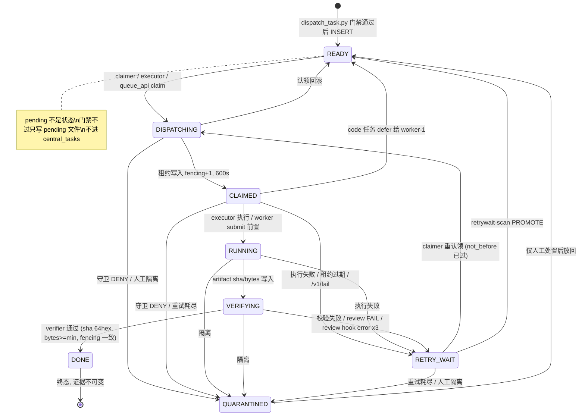

# 规范02《状态机流转与路由规范》

- 状态：**[初版待验证]**
- 适用范围：枢纽中央队列 `central_tasks` 任务状态机、OpenClaw 派发入口、认领/执行/核验/重试路由。
- 枢纽路径：`/home/ubuntu/ai-team`，SSH：`ssh arm-agent`

## 1. 真源（唯一依据，按优先级）

| # | 真源 | 作用 |
|---|---|---|
| 1 | `scripts/dispatch_task.py` | 合同门禁唯一强制入口，`--contract` 必填；门禁不过不写库、记 pending |
| 2 | 库内触发器 `central_tasks_transition_trg` → 函数 `public.central_tasks_transition_guard()` | 法定流转表（唯一强制执行者，见 §3） |
| 3 | 库内触发器 `central_tasks_done_immutable_trg` → `public.central_tasks_done_immutable()` | DONE 证据不可变 |
| 4 | `scripts/c2-verifier-20261104.py` | VERIFYING → DONE / RETRY_WAIT；review hook 300s、3 次 error 后 RETRY_WAIT |
| 5 | `scripts/taskcontract_gate.py` | 8 字段合同门禁（`--validate` / `--insert-guard`） |
| 6 | `scripts/c2-executor-20261104.py` | 生产执行器：READY → DISPATCHING → CLAIMED → RUNNING → VERIFYING |
| 7 | `scripts/queue_api-20261105.py` | worker 拉活 API：`/v1/claim`、`/v1/heartbeat`、`/v1/submit`、`/v1/fail` |
| 8 | `scripts/cq-csv-20261102.py` | claimer / sweeper 语义（RETRY_WAIT 重认领、租约过期回收） |
| 9 | `scripts/queue_watch.py` | 队列活性看门狗：UNCLAIMED 180s、STUCK 900s、重投上限 2 次 |
| 10 | `scripts/retrywait-scan-20261105.py` | RETRY_WAIT 扫描：backoff 分级、PROMOTE / BLOCKED / TERMINAL_FAILED |
| 11 | `scripts/health_3q-20261104.py` | 三问体检 Q1/Q2/Q3 与 exit 0/1/2/3 判据 |

> 口径：凡本规范写“已实测”，必有 §8 的真实命令输出为证；凡写“提案”或“待批”，表示代码/库内无锚点、尚未生效，不得当作现行规则执行。

## 2. 实测时间与命令（本规范的证据基线）

- 实测时间：**2026-11-06 11:23–11:26 CST**（03:23–03:26 UTC），执行机：`ssh arm-agent`，目录 `/home/ubuntu/ai-team`。
- 实测命令：
  - `python3 scripts/dispatch_task.py --help`
  - `python3 scripts/taskcontract_gate.py --help`
  - `python3 scripts/taskcontract_gate.py --validate /tmp/gate-probe-20261106.json`（临时文件，验后删除；只校验、不入库）
  - `python3 scripts/taskcontract_gate.py --insert-guard /tmp/gate-probe-20261106.json`
  - `python3 scripts/c2-verifier-20261104.py`（生产定时器同款调用）
  - `python3 scripts/health_3q-20261104.py`（11:25:04 手动实跑）
  - 只读 SQL：`SELECT status, COUNT(*) FROM central_tasks GROUP BY status`；`DONE_last_5h`；最新 DONE；`max_retries`；`central_leases` 分组；`information_schema.triggers` + `pg_get_functiondef`。
- 真实输出全文见 §8。以下结论全部出自这些输出与源码逐行阅读，不编造。

## 3. 法定流转表（触发器原文，库内实测）

触发器 `central_tasks_transition_trg` 已在库内确认存在（另有 `central_tasks_done_immutable_trg`、`central_tasks_audit_trg`）。函数 `central_tasks_transition_guard()` 的法定转移如下，**任何绕过触发器的写路径都不存在合法转移**：

| 当前状态 | 合法下一状态 | 说明 |
|---|---|---|
| （INSERT） | `READY` | 新行必须以 READY 落库，否则触发器直接抛错拒绝 |
| `READY` | `DISPATCHING`、`QUARANTINED` | 认领开始；或守卫 DENY 直接隔离 |
| `DISPATCHING` | `CLAIMED`、`READY`、`QUARANTINED` | 认领是两步：先 DISPATCHING 再 CLAIMED，禁止 READY → CLAIMED 直跳 |
| `CLAIMED` | `RUNNING`、`READY`、`RETRY_WAIT`、`QUARANTINED` | READY = code 任务 defer 回池；RETRY_WAIT = 执行失败/租约过期/工人主动 fail |
| `RUNNING` | `VERIFYING`、`RETRY_WAIT`、`QUARANTINED` | |
| `VERIFYING` | `DONE`、`RETRY_WAIT`、`QUARANTINED` | 只有 verifier 能判 DONE |
| `RETRY_WAIT` | `READY`、`QUARANTINED`、`DISPATCHING` | READY = retrywait-scan PROMOTE；DISPATCHING = claimer 直接重认领（not_before 已过且无 ACTIVE 租约） |
| `QUARANTINED` | `READY` | 唯一出路是人工处置后放回 READY |
| `DONE` | （无） | 终态；且 `artifact_sha` / `artifact_bytes` / `verified_by` / `current_fencing_token` 被 `done_immutable` 触发器锁死，不可改 |

非法转移一律由触发器抛错，例如：`READY → CLAIMED`（直跳）、`READY → RUNNING`、`VERIFYING → READY`、`DONE → *`（任何出 DONE 的转移）。

### 流转图



## 4. 每状态进入 / 退出条件表

| 状态 | 进入条件（谁、凭什么） | 退出条件（去哪、凭什么） | 租约 |
|---|---|---|---|
| `READY` | dispatch 门禁通过后 INSERT（`dispatch_task.py`，`--contract` 必填，见 §5）；或 `DISPATCHING`/`CLAIMED`/`RETRY_WAIT`/`QUARANTINED` 回落 | 被认领 → `DISPATCHING`（lane 顺序 P0 < biz < infra，再按 created_at；`FOR UPDATE SKIP LOCKED`，恰好一个认领者胜出） | 无 ACTIVE 租约方可认领（`NOT EXISTS` 守卫） |
| `DISPATCHING` | 认领事务第一步（`READY → DISPATCHING`，与 CLAIMED 同一事务） | 写入租约后 → `CLAIMED`；失败回滚 → `READY` | 租约在此步写入：`fencing = current+1`，`expires_at = now()+600s` |
| `CLAIMED` | 租约写入成功，`current_fencing_token` 更新 | 执行器产出 artifact → `RUNNING`；code 任务 defer → `READY`（租约 RELEASED，retry_count 不变）；执行异常 → `RETRY_WAIT`；守卫 DENY → `QUARANTINED` | ACTIVE 租约持有中；heartbeat 每 600s 续租（`/v1/heartbeat`，fencing 不符回 409） |
| `RUNNING` | executor 提交前置：`CLAIMED → RUNNING` 后立即 `→ VERIFYING`（同一提交路径，见 `c2-executor-20261104.py` 与 `queue_api` `/v1/submit`） | artifact 写入 → `VERIFYING`；执行失败 → `RETRY_WAIT` | 租约保持 ACTIVE（verifier 验 fencing 需要） |
| `VERIFYING` | artifact_sha / artifact_bytes 写入，`verified_by` 留空 | verifier 通过 → `DONE`；校验失败 → `RETRY_WAIT`（`retry_count+1`）；review FAIL → `RETRY_WAIT` + 方法7返工子任务（上限 2 次/根任务，超限写 incident 草稿）；review hook error 3 次 → `RETRY_WAIT`；error 1–2 次 → **留在 VERIFYING**、租约保留、下分钟重试 | 离开 VERIFYING 时租约一律 RELEASED；review error 未决时租约保留 |
| `DONE` | verifier 全项通过：fencing 与 ACTIVE 租约一致、sha 为 64 hex、`bytes >= min_bytes`、llm_doc 交付文件存在且 sha/bytes 与任务一致；llm_doc 且合同 `review_required=true` 时还须 review hook 返回 0 | 无退出。终态。证据字段不可变 | RELEASED |
| `RETRY_WAIT` | verifier 失败、执行器失败、租约过期（sweeper）、工人 `/v1/fail`（`retry_count < max_retries` 时；否则 `QUARANTINED`） | `not_before` 已过且无 ACTIVE 租约 → claimer 重认领（`→ DISPATCHING`）；或 retrywait-scan PROMOTE → `READY`；重试耗尽 → `QUARANTINED`（见 §6） | 永不持有 ACTIVE 租约（离开 VERIFYING 即释放；sweeper 先 EXPIRED 租约再移状态） |
| `QUARANTINED` | 守卫 DENY（执行器 `guard_check != AUTO`）、verifier DEAD 判定（`payload || '{"dead": true}'`）、`/v1/fail` 且 `retry_count >= max_retries`、人工隔离 | 仅人工处置后 → `READY` | RELEASED |
| `pending`（非状态） | 门禁不过（`dispatch_task.py` exit 1）：**不写库**，写 `state/m3-exit-20261105/pending/<task_id>.json`（`{"status": "pending", "gate_exit", "gate_output", ...}`），审计日志记 `refused_pending` | 修好合同重新派发；pending 文件本身不驱动任何流转 | 无 |
| `superseded`（非生产状态） | 仅见于 `scripts/c2v2-test-20261104.py` 测试 schema（review 失败父任务记 superseded）；生产 `central_tasks` 无此状态，不得写入 | — | — |
| `dead`（非生产状态） | 生产库无 `dead` 状态值。所谓 dead = `QUARANTINED` + `payload.dead=true`（`cq-csv-20261102.py` 注释原文：“DEAD is not a task status”）；方法7返工耗尽时写 incident 草稿、不删行 | 与 QUARANTINED 相同：仅人工处置后 → `READY` | — |

补充规则（源码实测）：

- **认领顺序**：lane P0 → biz → infra，再按 `created_at` 最老优先；`LIMIT 1 FOR UPDATE SKIP LOCKED`。
- **租约**：600 秒；heartbeat 续租同样 600 秒；sweeper 每分钟过期 ACTIVE 租约并把 `CLAIMED`/`RUNNING` 任务移入 `RETRY_WAIT`（`retry_count+1`）。
- **verifier 细节**（`c2-verifier-20261104.py`，每分钟跑一次）：
  - 只扫 `status='VERIFYING'`；
  - `patrol` 类型：`ceo-seat/out/patrol-latest.md` 超 900 秒未更新即判失败；
  - `code` 类型：交付文件须存在且 `bytes >= 500`，纯 `pytest_exit=0` 短文件（<1000B）判失败；
  - review hook（仅 `llm_doc` 且合同 `review_required=true`）：子进程超时 **300s**；exit 0 = PASS → DONE；exit 1 = FAIL → RETRY_WAIT；exit 2 = ERROR 无裁决 → 留 VERIFYING，下分钟重试，**累计 3 次 error 记录后 → RETRY_WAIT**（计数依据：`state/m5-20261105/review/` 下 `review-<task_id>-*.json` 文件数 ≥3）；kill-switch `state/m5-20261105/REVIEW-HOOK-DISABLED` 存在时跳过 hook、记 bypass。
  - 2026-11-06 11:25 实测：`c2-verifier: no verifying task`（当轮无 VERIFYING 任务）。
- **code 任务路由**（`c2-executor-20261104.py`，l3-20261105-1a）：枢纽不执行代码、不调模型，只校验 workdir 非空后释放租约、状态回 `READY`，由 worker-1 经 `queue_api/pull_once` 执行。

## 5. 派发门禁（OpenClaw 唯一强制入口）

- 入口：`python3 scripts/dispatch_task.py --contract <contract.json>`，`--contract` 必填（`--help` 实测见 §8）。
- 门禁本体：`scripts/taskcontract_gate.py --insert-guard`，子进程调用，超时 30s；8 字段必填非空：`task_type`、`input`、`output_path`、`evidence`、`pass_line`、`fail_action`、`verifier`、`forbidden`；`task_type` 白名单 `llm_doc / script / patrol / timer / code`；`code` 另须非空 `workdir`（顶层或 `input` 内）。
- 退出码：0 = 已插入 READY；1 = 门禁拒绝（已写 pending 文件，无任何 DB 写）；2 = 用法/重复 task_id / DB 错误（无插入）。
- fail-closed：无 DSN（`state/.cq-dsn`）拒绝插入；kill-switch `state/l3-20261105-contracts/GATE-DISABLED` 存在时门禁被绕过（记审计 `m3_gate=disabled-bypass`，仅回滚模式）。
- 每次尝试（允许/拒绝/绕过/重复）都追加到 `state/m3-exit-20261105/dispatch-audit.log.jsonl`。
- **不走门禁的例外（已定口径，`dispatch_task.py` 文档头）**：`timer_submit` / `patrol_submit` cron 提交器带硬编码最小 payload（type timer / patrol，无 8 字段合同），不进此门禁；它们是固定系统任务，不是 OpenClaw 派发。
- 实测 pending 现状：`state/m3-exit-20261105/pending/` 现有 3 个文件（`m3-gate-bad-01/02/03.json`）；审计日志最新两条均为 2026-11-05 21:57:52Z `inserted_ready`（`m5-datafields-rework-20261106`、`medium-eval-20261106`）。

## 6. 死锁判定边界

判定分级：**已实测**（代码/库内锚点 + 本次实测输出）与**提案**（无锚点，需批了才生效）。提案不得当作现行规则执行。

| # | 边界 | 分级 | 依据 / 实测 |
|---|---|---|---|
| 1 | `VERIFYING` 超 900s 未决 → 死锁告警 | **提案** | verifier 每分钟扫 VERIFYING，但源码无“VERIFYING 年龄超时”分支；唯一 900s 锚点是 patrol 文件过期判失败，不是 VERIFYING 停留超时。需新增看门狗分支后才生效。 |
| 2 | `RETRY_WAIT` 累计 ≤2 小时 → 超时转人工 | **提案** | 无代码锚点。生产路径从不写 `not_before`（只读它）；`retrywait-scan` 的 backoff 上限为 900s（F-429 类，`min(900, 30*2^retry)`），其余类别 0–30s；`retry_count >= max_retries` 时判 TERMINAL_FAILED。2 小时累计上限须先定义“累计”口径（`updated_at` 差值还是各次等待之和）并经批复。 |
| 3 | 单次等待 ≤15 分钟 | **已实测** | `queue_watch.py`：`STUCK_S = 900`——claimed 契约 15 分钟无证据包回传即 STUCK，自动重投 pending（上限 `MAX_REQUEUE = 2`）并告警；pending 无人认领超 180s 即 UNCLAIMED 告警，超 1800s（30 分钟）即 STALLED。另：租约 600s + sweeper 回收是更早的一道防线。 |
| 4 | `CLAIMED` 租约过期未回收 → 死锁 | **已实测** | 租约 600s，heartbeat 续 600s；sweeper 过期 ACTIVE 租约并移任务入 RETRY_WAIT。11:25 三问 supplement 实测租约回收率 **99.4%（1561/1570）**；DB 实查 leases：ACTIVE 9、EXPIRED 480、RELEASED 1081；ACTIVE 9 与 CLAIMED 9 一致，无孤儿租约。 |
| 5 | `DONE` 5 小时无新增即 Q2 红 | **提案（条件已成立，判据未生效）** | 见 §7。现状：条件本身为真，但现行 `health_3q` 的 Q2 判据仍会放过，需改脚本才生效。 |

### 最大重试

DB 实查：`max_retries` 全表统一为 **3**（min = max = 3）。耗尽路径：`/v1/fail` 在 `retry_count >= max_retries` 时直接进 `QUARANTINED`；verifier 侧的 DEAD 判定同样走 `QUARANTINED + payload.dead=true`；`retrywait-scan` 在 `retry_count >= max_retries` 且 `not_before` 已过时判 `TERMINAL_FAILED`（只写 outbox，不自动改状态）。

## 7. 三问实况与 Q2 红线（2026-11-06）

### 7.1 本次实测（11:25:04，exit 0）

手动实跑 `scripts/health_3q-20261104.py` 返回 `exit_code 0`，三问全过：

- Q1 能用：butler_synthetic true、可用池 2 模型、c2_executor/c2_verifier 日志新鲜（<10 分钟）。
- Q2 在做事（脚本口径）：`events_60min = 0`、`done_24h = 264` → 按脚本判据（`events_60min > 0 OR done_24h > 0`）判过。
- Q3 对吗：待决策 0、DONE sha 抽检 true、磁盘根 28.8% / 数据 40.5%。
- supplement 全过：网关 token 调用 ok（41 模型）、PG 9/100、容器重启增量 0、备份当日（10 天在库）、租约回收 99.4%、最老 READY 5.5 小时。

### 7.2 “5 小时无新 DONE”是 live 事实，但现行 Q2 不会变红

DB 只读实查（与 11:25 三问同轮）：

- 各状态计数：`CLAIMED 9、DONE 523、QUARANTINED 10、READY 7、RETRY_WAIT 14`（当轮无 DISPATCHING / RUNNING / VERIFYING 行）。
- **近 5 小时新 DONE = 0**；最新 DONE 为 `1779f438-711f-4352-bdfa-d00b3a8803e2`，`verified_at = 2026-11-05 21:51:01 UTC`，即 **2026-11-06 05:51 CST**，距实测时约 5.5 小时。
- 同轮三问 `events_60min = 0`，与 10:41 轮一致（该轮同样 `events_60min = 0`，另记：9 条 CLAIMED 滞留、金丝雀结果文件停在 04:32、定时任务结果停在 05:50）。

结论：**“DONE 5 小时无新增”这一事实成立，但它今天不会让 Q2 变红**——`health_3q` 的 Q2 只看 60 分钟事件数或 24 小时 DONE 数，24 小时窗口内仍有 264 件 DONE 就判过（01:34 轮已有先例：83 分钟无新 DONE，Q2 仍按脚本判据过）。把“5 小时无新 DONE 即 Q2 红”写进规范属于**提案**：须先改 `health_3q-20261104.py` 的 `q2_pass` 判据（增加“最新 DONE 年龄”项），并经批复，否则执行层无从触发。

### 7.3 关于“2026-11-06 11:10 三问 exit 2”引用的核实说明

- 本次核查未在枢纽找到 11:10 轮的三问结果文件（`state/` 下无 `health_3q` 结果落盘；`state/logs/` 只有各 timer 的 flock 日志），本地日志最新只到 11:08（ASCS 盯守），且**本次 11:25 手动实跑返回 exit 0**（见 §7.1）。
- 因此本规范**不把“11:10 exit 2”当作已验证事实引用**；§7.2 的 5 小时无新 DONE 结论以本次 DB 只读实查为准。如需补 11:10 轮的原始输出，须由当时执行方提供落盘文件或日志行，补入后再修订本节。
- 补充：`health_3q` 的 exit 码定义（源码）：0 = 三问全过；1 = Q1 过、Q2/Q3 部分；2 = Q1 部分通过；3 = Q1 失败（butler synthetic 非 DONE 或可用池 <2 或 C2 日志过期）。

## 8. 真实运行输出（原文粘贴）

### 8.1 `dispatch_task.py --help`（2026-11-06 11:23 CST）

```
usage: dispatch_task.py [-h] --contract CONTRACT

Production dispatch with TaskContract gate (M3 exit 1)

options:
  -h, --help           show this help message and exit
  --contract CONTRACT  contract JSON file (8-field TaskContract + task_id)
exit=0
```

### 8.2 `taskcontract_gate.py --help`

```
usage: taskcontract_gate.py [-h]
                            (--validate CONTRACT_JSON | --insert-guard CONTRACT_JSON)

TaskContract gate (l3-20261105-2a)

options:
  -h, --help            show this help message and exit
  --validate CONTRACT_JSON
                        validate a contract JSON file
  --insert-guard CONTRACT_JSON
                        insert guard: same validation, INSERT ALLOWED/REFUSED
exit=0
```

### 8.3 门禁实测（临时合同，只校验、不入库；验后删除）

```
$ python3 scripts/taskcontract_gate.py --validate /tmp/gate-probe-20261106.json
VALID
validate_exit=0
$ python3 scripts/taskcontract_gate.py --insert-guard /tmp/gate-probe-20261106.json
INSERT ALLOWED: contract valid
guard_exit=0
$ python3 scripts/taskcontract_gate.py --validate /tmp/gate-bad.json   # 仅 {"task_id": "x"}
INVALID: missing field: task_type; missing field: input; missing field: output_path; missing field: evidence; missing field: pass_line; missing field: fail_action; missing field: verifier; missing field: forbidden
bad_exit=1
```

注：本次未实跑 `dispatch_task.py --contract` 做真实插入（会写生产库），插入路径以 2026-11-05 21:57:52Z 审计日志的两条 `inserted_ready` 记录为证（§5）。

### 8.4 `c2-verifier-20261104.py`（11:25 轮）

```
c2-verifier: no verifying task
exit=0
```

### 8.5 `health_3q-20261104.py`（2026-11-06 11:25:04 CST，手动实跑）

```json
{"ts": "2026-11-06 11:25:04", "exit_code": 0, "q1_usable": true, "q2_working": true, "q3_correct": true,
 "q1": [["butler_synthetic", true], ["pool_models", 2], ["c2_executor_fresh", true], ["c2_verifier_fresh", true]],
 "q2": [["events_60min", 0], ["done_24h", 264]],
 "q3": [["pending_decisions", 0], ["done_sha_spotcheck", true], ["disk_root_pct", 28.8], ["disk_root_used_total_gb", "24/82"], ["disk_data_pct", 40.5]],
 "supplement": {"metrics": {"gateway_token_call": {"ok": true, "model_count": 41}, "pg_connections": {"used": 9, "max": 100}, "container_restarts": {"increment": 0}, "inode": {"/": "6%", "/data": "11%"}, "backup": {"latest_date": "2026-11-06", "days_present": 10, "age_h": 3.4}, "queue_oldest_ready_h": 5.5, "lease_reclaim": {"total": 1570, "reclaimed": 1561, "rate_pct": 99.4}, "decision_queue": {"pending_count": 0}}, "checks": {"gateway_token_ok": true, "pg_ratio_ok": true, "restart_inc_ok": true, "inode_ok": true, "backup_age_ok": true, "ready_age_ok": true, "decision_pending_ok": true, "lease_rate_ok": true}, "all_pass": true, "dry_run": true},
 "supplement_pass": true, "notes": [], "disk_touchline_note": "trend not yet built; <85% with no disk alert reported as pass"}
```

### 8.6 DB 只读快照（2026-11-06 约 11:26 CST）

```
central_tasks 按状态计数: [('CLAIMED', 9), ('DONE', 523), ('QUARANTINED', 10), ('READY', 7), ('RETRY_WAIT', 14)]
DONE_last_5h = 0
latest_DONE = (UUID('1779f438-711f-4352-bdfa-d00b3a8803e2'), 2026-11-05 21:51:01 UTC)  # = 2026-11-06 05:51 CST
max_retries min/max = (3, 3)
leases: [('EXPIRED', 480), ('ACTIVE', 9), ('RELEASED', 1081)]
触发器: central_tasks_transition_trg / central_tasks_done_immutable_trg / central_tasks_audit_trg
```

### 8.7 执行器/核验器日志尾巴（同轮）

```
c2-executor: claimed b31237b4-f381-4f10-bbac-d65a33982016 fencing=69 type=code
c2-executor: code deferred to worker-1 b31237b4-f381-4f10-bbac-d65a33982016 workdir=~/code-agent-pilot/workdir/
c2-executor: routed-to-worker-1 b31237b4-f381-4f10-bbac-d65a33982016 status=READY retry_count unchanged
c2-verifier: no verifying task
```

（注：执行器每分钟认领同一 code 任务后 defer 回 READY 的循环，已在 10:41 三问轮记录为已知饥饿机制，不属本规范新发现；处理待定夺，不擅自操作。）

## 9. OpenClaw 派发失败重试 / 挂起告警 —— 规范代码

> **本节代码是“规范代码，待接线”，不是已实测的生产代码。**
> 依据：`dispatch_task.py` 本身**没有重试逻辑**（exit 0/1/2 + 审计日志 + pending 文件即全部行为）；枢纽现有告警路径是 `queue_watch.py`（UNCLAIMED/STUCK/重投上限 2 次）、`deadletter_watchdog.py`、`alert_egress.py`（`no_receipt_10min` / `deadletter` / 故障）三条，未发现 OpenClaw 专用的派发重试模块。下述伪代码照 `dispatch_task.py` 的 gate + insert 逻辑写，接线前须先过评审、再挂定时器，**不得直接当作已上线代码引用**。

```python
#!/usr/bin/env python3
"""openclaw_dispatch_retry.py — 规范代码，待接线（未上线、未实测）。
照 scripts/dispatch_task.py 的 gate + insert 逻辑写：门禁不过只记 pending、
不写库；DB/网关类失败才重试；重试耗尽挂起告警，不静默丢弃。
接线点（待批）：cron 每分钟扫 state/m3-exit-20261105/pending/；
告警落点沿用 state/alerts.log + state/queue_alerts.json（queue_watch 同款）。
"""
import json, os, subprocess, sys, time

BASE = "/home/ubuntu/ai-team"
PENDING_DIR = BASE + "/state/m3-exit-20261105/pending"
DISPATCH = BASE + "/scripts/dispatch_task.py"
MAX_ATTEMPTS = 3          # 提案：与 max_retries=3 对齐（DB 实查全表统一为 3）
RETRY_BACKOFF_S = [60, 300, 900]   # 提案：单次等待 ≤15 分钟（§6 边界 3）
ALERT_LOG = BASE + "/state/alerts.log"

def _alert(kind, task_id, detail):
    line = "%s %s %s %s\n" % (time.strftime("%Y-%m-%dT%H:%M:%SZ", time.gmtime()),
                              kind, task_id, detail)
    with open(ALERT_LOG, "a", encoding="utf-8") as f:
        f.write(line)

def redispatch(contract_path):
    """返回 (ok, exit_code)。exit 1 = 门禁拒绝：不重试，只记 pending，等人工修合同。"""
    r = subprocess.run([sys.executable, DISPATCH, "--contract", contract_path],
                       capture_output=True, text=True, timeout=60)
    return (r.returncode == 0), r.returncode

def main():
    for fn in sorted(os.listdir(PENDING_DIR)):
        if not fn.endswith(".json"):
            continue
        prec = json.load(open(os.path.join(PENDING_DIR, fn), encoding="utf-8"))
        task_id = prec.get("task_id", fn[:-5])
        attempts = int(prec.get("dispatch_attempts", 0))
        # 门禁拒绝（gate_exit=1）不重试：合同本身不合格，重试只会重复拒绝。
        if prec.get("gate_exit") == 1:
            _alert("PENDING_GATE_REFUSED", task_id,
                   "gate refused; fix contract, no auto-retry")
            continue
        # 其余失败（DB 错误 exit 2 / 网关异常）按退避重试，最多 3 次。
        if attempts >= MAX_ATTEMPTS:
            _alert("DISPATCH_SUSPENDED", task_id,
                   "attempts=%d exhausted; suspended, needs human" % attempts)
            continue
        ok, rc = redispatch(prec.get("contract_file", ""))
        prec["dispatch_attempts"] = attempts + 1
        prec["last_attempt_ts"] = time.strftime("%Y-%m-%dT%H:%M:%SZ", time.gmtime())
        prec["last_exit"] = rc
        with open(os.path.join(PENDING_DIR, fn), "w", encoding="utf-8") as f:
            json.dump(prec, f, ensure_ascii=False, indent=2, sort_keys=True)
        if not ok and prec["dispatch_attempts"] >= MAX_ATTEMPTS:
            _alert("DISPATCH_SUSPENDED", task_id,
                   "attempts=%d exhausted exit=%d; suspended" % (prec["dispatch_attempts"], rc))

if __name__ == "__main__":
    sys.exit(main())
```

接线检查单（未做，待批后执行）：

1. 门禁拒绝（exit 1）永不自动重试——合同错了，重试无意义，只告警等人修。
2. 只有 exit 2（DB 错误/重复/用法）与执行异常才进退避重试，最多 3 次、退避 60s → 300s → 900s（单次 ≤15 分钟）。
3. 耗尽后写 `DISPATCH_SUSPENDED` 告警并停手，不删 pending 文件、不静默丢弃。
4. 告警落点与 `queue_watch.py` 一致（`state/alerts.log` + `state/queue_alerts.json`），不另起通道。

## 10. 未核实 / 待办（不回避）

1. “2026-11-06 11:10 三问 exit 2”原始输出未找到（§7.3）；本规范的 Q2 结论以 11:25 手动实跑（exit 0）与 DB 只读快照为准。
2. 边界 1（VERIFYING 超 900s）与边界 2（RETRY_WAIT 累计 ≤2 小时）无代码锚点，属提案；边界 5（DONE 5 小时无新增即 Q2 红）须先改 `health_3q` 判据。
3. `dispatch_task.py --contract` 真实插入未在本轮实跑（避免写生产库）；插入路径以 2026-11-05 审计日志为准。
4. `superseded` / `dead` 不是生产状态值，写入 `central_tasks.status` 会触发器报错；对外口径须用 `QUARANTINED + payload.dead=true`。
5. 执行器每分钟认领同一 code 任务 `b31237b4` 后 defer 回 READY 的饥饿循环（10:41 轮已记），属已知待定夺项，本规范不擅自给解法。

---

*起草：2026-11-06；证据基线：2026-11-06 11:23–11:26 CST 枢纽实测；下次修订须先重跑 §2 命令并更新 §8 输出。*
